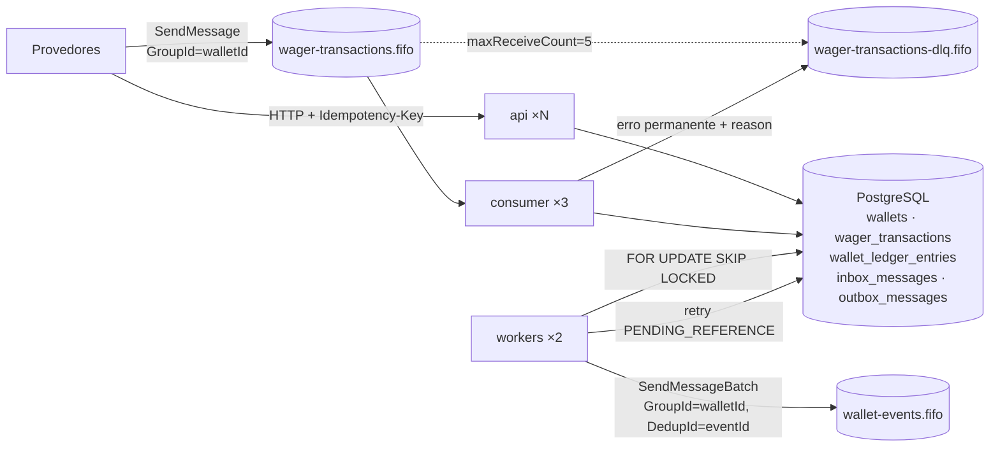

# Arquitetura — Distributed Wagering Processor

Este documento explica **como** o serviço garante corretude financeira e **por que** cada decisão foi tomada, com os trade-offs e as limitações conhecidas. Ele descreve o código como está; quando difere da [spec](docs/superpowers/specs/2026-11-10-wagering-processor-design.md), vale o código e a diferença é apontada. As regras invioláveis estão na [constitution](docs/constitution.md), citada como "C#n".

## Sumário

- [Visão geral](#visão-geral)
- [Camadas e regra de dependência](#camadas-e-regra-de-dependência)
- [Modelo de domínio e máquina de estados](#modelo-de-domínio-e-máquina-de-estados)
- [Dinheiro (`Money`)](#dinheiro-money)
- [Persistência e ORM](#persistência-e-orm)
- [Schema e invariantes no banco](#schema-e-invariantes-no-banco)
- [Concorrência](#concorrência)
- [Idempotência](#idempotência)
- [Fluxo do submit](#fluxo-do-submit)
- [Referências fora de ordem (`PENDING_REFERENCE`)](#referências-fora-de-ordem-pending_reference)
- [Mensageria: consumer SQS](#mensageria-consumer-sqs)
- [Transactional outbox e eventos](#transactional-outbox-e-eventos)
- [Erros, `failureCode` e HTTP](#erros-failurecode-e-http)
- [Observabilidade](#observabilidade)
- [Autenticação](#autenticação)
- [Testes](#testes)
- [Interpretações adotadas](#interpretações-adotadas)
- [Limitações e próximos passos](#limitações-e-próximos-passos)

---

## Visão geral

Um repositório e uma imagem Docker. O mesmo código roda como **três serviços**, cada um com seu entrypoint e escalável de forma independente:

| Serviço | Entrypoint | Papel |
|---|---|---|
| `api` | `src/main.api.ts` | HTTP (NestJS + Express): wallets, submissão, consultas, reconciliação |
| `consumer` | `src/main.consumer.ts` | Long polling de `wager-transactions.fifo`; usa **o mesmo** `SubmitWagerTransaction` da API (C#22) |
| `workers` | `src/main.workers.ts` | `OutboxPublisherWorker` (outbox → `wallet-events.fifo`) e `PendingReferenceWorker` (transações à espera da referência) |
| `migrate` | `src/main.migrate.ts` | Aplica as migrations e termina; os outros dependem dele no Compose |



Nenhuma garantia depende de estado em memória (C#11). Unicidade, ordem de aplicação por wallet, deduplicação e entrega de eventos vivem no PostgreSQL. As features de FIFO do SQS (ordem por grupo, dedup de 5 min) são só otimização (C#14).

## Camadas e regra de dependência

Monólito modular em estilo hexagonal:

```
interfaces  →  application  →  domain
                    ↑
             infrastructure (implementa application/ports)
```

| Camada | Conteúdo | Regras |
|---|---|---|
| `src/domain` | `Money`, `Wallet` (aggregate root), `WalletLedgerEntry`, `WagerTransaction`, `settle` (serviço de domínio), eventos, `InboxMessage`, `OutboxMessage`, `backoff`, `FailureCode` | TypeScript puro. Não importa NestJS, MikroORM, AWS SDK, pino, prom-client nem zod (C#19). Construtores `private` e factories `create`/`open`/`from`/`rehydrate`; `rehydrate` não valida (C#20) |
| `src/application` | Use cases, ports (`UnitOfWork`, repositórios, `Clock`, `IdGenerator`, `EventPublisher`, `Metrics`, `AppLogger`, `FaultInjector`, `ProviderIdentityPort`), hashing canônico, erros de aplicação | Orquestra a transação. Não conhece SQL, HTTP nem SQS |
| `src/infrastructure` | Schemas `defineEntity`, mappers, repositórios, `MikroOrmUnitOfWork`, migration, cliente/publisher SQS, pino, prom-client, health, `loadEnv`, auth (no-op e guard JWT do Keycloak), relógio e ids UUID v7 | Implementa as ports e traduz erros de driver em erros de aplicação |
| `src/interfaces` | Controllers HTTP + zod + filtro problem+json, consumer SQS e sua classificação, laços de polling dos workers, módulos Nest | Adaptadores de entrada; não contêm regra de negócio |

Consequência prática: as regras de negócio (state machine, settlement, Money, backoff) são testadas sem IO em `test/unit`, e HTTP e SQS não têm como divergir, porque chamam o mesmo `execute`.

## Modelo de domínio e máquina de estados

- **`Wallet`** (`src/domain/wallet/wallet.ts`). Estado: `balance: Money`, `version`. `debit`/`credit` validam moeda e valor positivo, aplicam a mudança, incrementam `version` e **retornam o `WalletLedgerEntry`** com `balanceBefore`, `balanceAfter` e `walletVersion = nova version`. Não existe forma de mudar saldo sem produzir o lançamento. `debit` que deixaria saldo negativo lança `InsufficientFundsError`; `credit` acima de `numeric(20,2)` lança `BalanceLimitExceededError`. `Wallet.open` com saldo inicial > 0 devolve o lançamento de abertura (`walletVersion = 1`).
- **`WalletLedgerEntry`**: imutável; `create` valida `balanceBefore ± money = balanceAfter`, `money > 0` e moedas iguais.
- **`WagerTransaction`** (`src/domain/wagering/wager-transaction.ts`): kinds `OPENING` (só interno, via `createOpening`), `BET`, `WIN`, `LOSS`, `REFUND`, `ROLLBACK`. `create` recusa `OPENING`, exige referência em `REFUND`/`ROLLBACK`, recusa referência em `BET` e exige valor > 0.

Transições (`assertStatus` lança `InvalidTransactionStateError`, que é erro de programação, não `DomainError`):

| De | Para | Método | Efeito |
|---|---|---|---|
| (criação) | `PENDING` | `create` | só existe em memória durante o submit |
| `PENDING` / `PENDING_REFERENCE` | `PROCESSED` | `markProcessed(referenceTransactionId?, observedBalance, at)` | grava `processed_at`, `observed_balance`, limpa `next_attempt_at` |
| `PENDING` / `PENDING_REFERENCE` | `REJECTED` | `reject(code, observedBalance, at)` | grava `failure_code` e `observed_balance` |
| `PENDING` | `PENDING_REFERENCE` | `markPendingReference(nextAttemptAt, at)` | agenda a primeira tentativa do worker |
| `PENDING_REFERENCE` | `PENDING_REFERENCE` | `scheduleReferenceRetry(nextAttemptAt, at)` | `attempts++`, reagenda |
| `PENDING` / `PENDING_REFERENCE` | `FAILED` | `fail(code, at)` | só `INTERNAL_PROCESSING_ERROR` |
| `PROCESSED` / `REJECTED` / `FAILED` | — | qualquer | lança (C#21); o trigger `wager_transactions_guard` repete a regra no banco |

`PENDING` nunca é persistido como estado final: o submit decide dentro da mesma transação SQL.

**`settle`** (`src/domain/wagering/wager-settlement.ts`) é uma função pura usada pelo submit e pelo worker. Ela só altera a wallet em `PROCESSED`. Ordem das verificações (a primeira que falha decide):

1. Identidade: `playerId`/`walletId` do payload ≠ dono/id da wallet → `PLAYER_WALLET_MISMATCH`; moeda ≠ moeda da wallet → `CURRENCY_MISMATCH`.
2. Referência declarada e inexistente → `PENDING_REFERENCE`.
3. Referência `PENDING`/`PENDING_REFERENCE` → `PENDING_REFERENCE`.
4. Referência `REJECTED`/`FAILED` → `REFERENCE_NOT_REVERSIBLE`.
5. Provider, player, wallet, moeda ou `roundId` diferentes → `REFERENCE_MISMATCH`.
6. Kind da referência não permitido → `REFERENCE_KIND_NOT_ALLOWED`. Permitidos: `WIN`/`LOSS`/`REFUND` → só `BET`; `ROLLBACK` → `BET`, `WIN` ou `REFUND`.
7. Só para `REFUND`/`ROLLBACK`: valor diferente → `REFERENCE_AMOUNT_MISMATCH`; já revertida → `REFERENCE_ALREADY_REVERSED`.
8. Efeito: `BET` debita (`INSUFFICIENT_FUNDS`), `WIN`/`REFUND` creditam (`BALANCE_LIMIT_EXCEEDED`), `LOSS` não gera lançamento, `ROLLBACK` aplica o inverso da direção da referência (débito sem saldo → `REVERSAL_INSUFFICIENT_FUNDS`).

## Dinheiro (`Money`)

`src/domain/money/money.ts`, implementação própria, sem dependência externa:

- **Interno:** `bigint` em unidades mínimas + `currency` (`^[A-Z]{3}$`). Operações retornam nova instância (C#2); moedas diferentes lançam `CurrencyMismatchError`.
- **Contrato:** `Money.from({ amount, currency })` só aceita `^(0|[1-9][0-9]{0,17})\.([0-9]{2})$`: exatamente 2 casas, sem sinal, sem expoente, sem zeros à esquerda, até 18 dígitos inteiros. Não há arredondamento (C#3): `"10"`, `"10.5"`, `"1.234"`, `"1e3"` e `"-1.00"` são rejeitados. `toJSON()` devolve `{amount: "25.00", currency: "BRL"}`. `number` não aparece em nenhum ponto (C#1).
- **Banco:** `numeric(20,2)` + `char(3)`. O teto de `numeric(20,2)` (`MONEY_MAX_MINOR_UNITS`) é verificado em `credit`, que gera `BALANCE_LIMIT_EXCEEDED` antes de o banco recusar.
- **Mapeamento:** `MoneyAmountType` (`src/infrastructure/persistence/money-amount.type.ts`) é um custom type MikroORM `string ↔ string`. O driver `pg` devolve `numeric` como string, e o tipo **falha** se receber outra coisa (driver mal configurado nunca vira `number` silenciosamente). Os mappers fazem `Money.from({ amount: record.balance, currency: record.currency })`, ou seja, o formato é revalidado ao ler. Somas do ledger (`LedgerRepository.totals`) podem passar do teto de `numeric(20,2)`, por isso vêm do SQL como texto `round(sum, 2)` e são convertidas para unidades mínimas com `Money.fromMinorUnits`.

Limitação aceita: escala fixa 2 para todas as moedas.

## Persistência e ORM

**MikroORM 7** (preferencial no desafio), com `defineEntity` + `setClass`, **sem decorators** (`src/infrastructure/persistence/schemas/*.schema.ts`). O MikroORM 7 tirou os decorators do core, e o desenho isola a persistência: os schemas descrevem *records*, os mappers (`mappers/*.mapper.ts`) convertem record ↔ entidade de domínio, e o domínio não sabe que existe ORM. A config (`mikro-orm.config.ts`) declara `driver: PostgreSqlDriver` explicitamente, `allowGlobalContext: false`, pool `DB_POOL_MAX` e migrations sem snapshot. O schema é escrito à mão, porque constraints, índices parciais e triggers não saem de diffs.

Alternativas consideradas: TypeORM (entidades acopladas a decorators), Prisma (lock pessimista só via SQL cru e client gerado) e Drizzle/Kysely (query builders, sem a camada de mapeamento/migrations integrada). O MikroORM é o preferencial do desafio e permite manter o domínio sem decorators.

Decisões sobre como usar o ORM:

- **Escrita com SQL imediato.** Os repositórios usam `em.insert` e `em.nativeUpdate`, não `persist` + `flush`. Assim a ordem dos statements é a ordem das chamadas, e uma violação de unicidade aparece **na chamada**, com o nome da constraint. A regra de "uma nova execução após unique violation" do submit e o mapeamento `WALLET_ALREADY_EXISTS` dependem disso. `nativeUpdate` passa por `assertSingleRow`: atualizar ≠ 1 linha é bug e aborta a transação.
- **Leitura sem identity map** (`FRESH = { disableIdentityMap: true }`, `repositories/read-options.ts`). Como as escritas não passam pelo identity map, uma leitura em cache poderia devolver uma cópia velha carregada antes na mesma transação; toda leitura vai ao banco.
- **Locks** com `lockMode: PESSIMISTIC_WRITE` (`SELECT … FOR UPDATE`) em `wallets.lockById` e `transactions.lockById`. O lote do outbox usa SQL explícito com `FOR UPDATE SKIP LOCKED`.

Trade-off: abre-se mão do change tracking do MikroORM. Ele fica como mapeador tipado, query builder, gestor de conexões/transações e runner de migrations. Em troca, o comportamento transacional fica explícito e previsível, que é o que importa num ledger.

**`UnitOfWork`** (`src/application/ports/unit-of-work.ts`, implementado por `src/infrastructure/persistence/mikro-orm-unit-of-work.ts`):

- `run(fn)` = `orm.em.fork().transactional(...)`: uma transação SQL e repositórios ligados a ela.
- Primeiro statement: `set_config('lock_timeout', '5000ms', true)` e `set_config('statement_timeout', '15000ms', true)` (equivale a `SET LOCAL`).
- `{ isolation: 'repeatable read' }` opcional, usado pela reconciliação para ler wallet e ledger no mesmo snapshot. O resto usa `READ COMMITTED` + locks explícitos.
- `{ idleInTransactionTimeoutMs }` opcional: `set_config('idle_in_transaction_session_timeout', …, true)`. Usado pelo outbox publisher, cuja transação espera o SQS (30 s).
- **Timeout de conexão:** `driverOptions: { connectionTimeoutMillis: 5000 }` no `mikro-orm.config.ts` (o `pool` do MikroORM só repassa `min`/`max`/`idleTimeoutMillis`; `driverOptions` vai direto para o `Pool` do `pg`). `statement_timeout` só vale depois de conectado; isso limita o próprio connect contra um host inalcançável ou mudo, e também a espera por uma conexão livre do pool.
- Tradução de erros (`pg-errors.ts`, seguindo a cadeia de `.cause`): `23505` → `UniqueViolationError(constraint)`; `55P03` (lock timeout) → `TransientInfraError` + `db_lock_conflicts_total`; `57014`, `53300`, `57P01`, `40P01` (deadlock), `40001` (serialização), classe `08xxx`, os códigos de socket/DNS `ECONNREFUSED`/`ECONNRESET`/`ETIMEDOUT`/`ENOTFOUND`/`EAI_AGAIN`/`EPIPE`/`EHOSTUNREACH`/`ENETUNREACH` e os erros sem código do `pg` (`Connection terminated…`, `…not queryable`, `timeout exceeded when trying to connect`) → `TransientInfraError`. `ENOTFOUND`/`EAI_AGAIN` são o que um `docker compose stop postgres` produz (o nome `postgres` some do DNS). Violações de CHECK, trigger e FK (`23514`, `23000`, `23503`) passam como estão: são erros de programação e acabam em `FAILED`.

Todo efeito financeiro (transação, wallet, ledger, inbox, outbox) acontece dentro de **um** `run` (C#15). Nenhum adapter SQS é chamado dentro de um `run`, com uma exceção deliberada: o outbox publisher (ver [outbox](#transactional-outbox-e-eventos)).

## Schema e invariantes no banco

Uma migration: `src/infrastructure/persistence/migrations/Migration20261111000000Initial.ts` (com `down` completo; o teste `migrations.test.ts` faz `up → down → up`). O código é a primeira barreira e o banco é a última (C#4). Os triggers erram com SQLSTATE `23000` e o nome do guard no campo `constraint`, como uma constraint nativa.

### `wallets`

| Constraint / trigger | Garante |
|---|---|
| `wallets_balance_check` `balance >= 0` | Saldo nunca negativo, em qualquer interleaving (C#7) |
| `wallets_currency_check`, `wallets_version_check` (`>= 1`) | Formato |
| `wallets_player_id_currency_key` `UNIQUE (player_id, currency)` | Uma wallet por jogador e moeda; vira `WALLET_ALREADY_EXISTS` |
| `wallets_version_guard` (BEFORE UPDATE) | `id`, `player_id`, `currency`, `created_at` imutáveis; saldo mudou ⇔ `version = OLD.version + 1`; `version` não muda sem saldo mudar |
| `wallets_ledger_consistency` (constraint trigger AFTER INSERT/UPDATE, `DEFERRABLE INITIALLY DEFERRED`) | No COMMIT, se o saldo mudou (ou a wallet nasceu com saldo > 0), existe lançamento com `wallet_version = version` e `balance_after = balance`. Deferido para não impor ordem entre o UPDATE da wallet e o INSERT do lançamento |

### `wallet_ledger_entries` (append-only, C#5)

| Constraint / trigger | Garante |
|---|---|
| `direction IN ('DEBIT','CREDIT')`, `amount > 0`, `balance_after >= 0`, `wallet_version >= 1` | Formato |
| `wallet_ledger_entries_arithmetic_check` | `balance_after = balance_before ∓ amount` conforme a direção |
| `UNIQUE (wallet_id, transaction_id)` | Uma transação gera no máximo um lançamento por wallet |
| `UNIQUE (wallet_id, wallet_version)` | Cadeia sem bifurcação; é também o índice da paginação por cursor |
| `ledger_chain_guard` (BEFORE INSERT) | Moeda do lançamento = moeda da wallet; a transação pertence à mesma wallet; `balance_before` = `balance_after` do lançamento `wallet_version − 1`; sem predecessor, só é válido um início de cadeia (versão 1 ou 2, a partir de saldo 0, wallet sem lançamentos) |
| `ledger_wallet_consistency` (constraint trigger deferida) | O espelho do trigger da wallet: no COMMIT, o lançamento não está "à frente" da wallet, e se a versão coincide, o saldo coincide. Junto com `wallets_ledger_consistency`, fecha "toda alteração de saldo tem exatamente um lançamento, **e vice-versa**" (C#6) |
| `ledger_append_only` (BEFORE UPDATE/DELETE) e `ledger_append_only_truncate` (BEFORE TRUNCATE) | Nenhum lançamento é alterado ou apagado, nem por SQL manual |

A cadeia começa em `wallet_version = 1` (wallet aberta com saldo > 0, lançamento da transação `OPENING`) ou `2` (wallet aberta com zero; o primeiro crédito leva a wallet de 1 para 2).

### `wager_transactions`

| Constraint / índice / trigger | Garante |
|---|---|
| `UNIQUE (idempotency_key)` | Idempotência persistente (C#12) |
| `UNIQUE (provider_id, external_transaction_id)` | Um id externo por provedor; outra chave → `EXTERNAL_ID_CONFLICT` |
| `kind`/`status`/`failure_code` em enums; `amount > 0`; `payload_hash ~ '^[0-9a-f]{64}$'`; `attempts >= 0` | Formato |
| `round_game_check` | Só `OPENING` vive fora de rodada |
| `reference_required_check` | `REFUND`/`ROLLBACK` sempre declaram referência |
| `reversal_reference_check` | Reversão `PROCESSED` aponta `reference_transaction_id`. Sem isso, o índice único abaixo não a enxergaria, porque NULLs são distintos |
| `failure_code_status_check`, `processed_at_status_check`, `next_attempt_at_status_check` (bicondicionais) | As colunas de ciclo de vida espelham exatamente o status |
| `observed_balance_check` | `PROCESSED`/`REJECTED` sempre gravam o saldo observado (base do replay) |
| `wager_transactions_single_reversal_key` `UNIQUE (reference_transaction_id) WHERE kind IN ('REFUND','ROLLBACK') AND status='PROCESSED'` | Uma transação é revertida no máximo uma vez, **qualquer que seja o tipo de reversão** |
| `wager_transactions_guard` (BEFORE UPDATE) | Linha terminal não muda; campos de negócio (`provider_id` … `reference_external_transaction_id`, `idempotency_key`, `payload_hash`, `created_at`) são imutáveis |
| FK `wallet_id → wallets`, FK `reference_transaction_id → wager_transactions` | Integridade referencial; por causa da FK, `WALLET_NOT_FOUND` não é persistível |
| Índices `(wallet_id)`, `(provider_id, reference_external_transaction_id)` e parcial `(next_attempt_at) WHERE status='PENDING_REFERENCE'` | Nudge de dependentes e varredura do worker |

### `inbox_messages` e `outbox_messages`

- `inbox_messages`: `PRIMARY KEY (consumer_name, message_id)` + `payload_hash` validado. A mensagem nasce processada, dentro da transação financeira.
- `outbox_messages`: `id` = `eventId`; `payload jsonb`; `CHECK (published_at IS NOT NULL OR next_attempt_at IS NOT NULL)`, para que mensagem pendente sempre seja alcançável pelo índice parcial `outbox_messages_due_idx (next_attempt_at) WHERE published_at IS NULL`. O trigger `outbox_guard` impede alterar `aggregate_id`, `event_type`, `payload`, `occurred_at` e "despublicar" ou republicar (C#18).

Cobertura: `test/integration/schema/constraints.test.ts` ataca cada constraint e trigger com SQL direto, contornando o código.

## Concorrência

**Estratégia: lock pessimista por wallet.** Todo comando financeiro começa com `SELECT … FROM wallets WHERE id = $1 FOR UPDATE` (C#9). A unidade de concorrência é a wallet; não existe lock global (C#8). Transações em wallets diferentes não se esperam; transações na mesma wallet são serializadas pelo Postgres na ordem de chegada ao lock. O `CHECK (balance >= 0)`, o `version++` validado por trigger e as constraint triggers do ledger ficam como última barreira se o código errar.

**Ordem de lock (C#10):** cada transação SQL trava **no máximo uma wallet**, e sempre **wallet primeiro**, depois linhas de transação:

| Componente | Locks, em ordem |
|---|---|
| `SubmitWagerTransaction` | `wallets FOR UPDATE` → INSERTs (tx, ledger, outbox, inbox) → `UPDATE` da wallet → nudge de dependentes **da mesma wallet** (interpretação 15) |
| `recordFailure` (gravação de `FAILED`) | transação própria: `wallets FOR UPDATE` → INSERT |
| `RetryPendingReferences` | candidatos lidos **sem lock** → por candidato, transação própria: `wallets FOR UPDATE` → `wager_transactions FOR UPDATE` → recheca status e vencimento |
| `OpenWallet` | INSERT da wallet nova (ninguém mais a enxerga) |
| `PublishOutbox` | só linhas de `outbox_messages` (`SKIP LOCKED`), nunca wallet |
| `ReconcileWallet`, consultas | sem lock (`REPEATABLE READ` na reconciliação) |

A referência é lida **sem lock**. Se for da mesma wallet, já está protegida pelo lock da wallet; se for de outra, o resultado é `REFERENCE_MISMATCH` de qualquer forma.

**Análise de deadlock.** Um ciclo exigiria duas transações segurando wallets diferentes e cada uma esperando a da outra, o que não acontece porque ninguém trava uma segunda wallet. As esperas restantes também não formam ciclo:

- Mesma `idempotency_key` em duas wallets: T2 espera no índice único o commit de T1 e recebe `23505`. É a única espera entre wallets, e T1 nunca espera T2.
- FKs (`FOR KEY SHARE` na wallet e na transação referenciada) só tocam linhas da própria wallet já travada.
- O worker trava a linha da transação depois da wallet, como todo mundo.

Mesmo assim, `40P01` e `40001` são classificados como transitórios: a transação inteira foi desfeita e repetir é seguro. A métrica continua contando.

**`lock_timeout = 5s`.** Uma hot wallet muito disputada ou um lock esquecido não seguram conexões indefinidamente: o Postgres aborta com `55P03`, o UoW converte em `TransientInfraError`, a API responde 503 com `Retry-After: 1` e o consumer devolve a mensagem com backoff. Nada foi gravado, e o retry passa pela idempotência. `statement_timeout = 15s` limita qualquer statement.

**Por que não lock otimista.** Com `version` + `UPDATE … WHERE version = $v`, uma hot wallet (o cenário obrigatório 2 e o caso real de um jogador com muitas apostas simultâneas) gera tempestade de conflitos e retries. A latência fica não determinística e a fila de retries cresce com a concorrência. O lock pessimista serializa sem retry, e cada transação dura alguns milissegundos (sem IO externo dentro dela). O custo é que o throughput **por wallet** fica limitado à vazão serial, o que é aceitável: o domínio já é sequencial por wallet. O cenário 3 prova que wallets diferentes não se serializam. `version` existe mesmo assim: é a posição na cadeia do ledger, o cursor da paginação e um guard do trigger.

**Multi-instância.** Nada é coordenado em memória. N `api` e N `consumer` competem pelo mesmo lock no banco; N `workers` dividem a outbox por `SKIP LOCKED` e os candidatos pendentes por "lock + rechecagem".

## Idempotência

Três camadas, todas persistentes (C#12):

| Camada | Chave | Pega |
|---|---|---|
| Inbox (só SQS) | `PRIMARY KEY (consumer_name, message_id)` | Reentrega da **mesma mensagem** (crash entre commit e ack, visibility expirada) |
| Chave de idempotência | `UNIQUE (idempotency_key)` | A mesma operação reenviada, por HTTP, por SQS com outro `messageId`, ou por ambos |
| Id externo | `UNIQUE (provider_id, external_transaction_id)` | A mesma operação do provedor com outra chave → `EXTERNAL_ID_CONFLICT` |

**Hash do payload** (`src/application/hashing/payload-hash.ts` + `canonical-json.ts`):

- Algoritmo: **SHA-256**, hex minúsculo (64 caracteres, validado por CHECK no banco), via `Bun.CryptoHasher`.
- Entrada: **canonical JSON** dos campos de negócio, com chaves ordenadas recursivamente, sem espaços, membros `undefined` omitidos e números não inteiros recusados.
- Campos no hash: `providerId`, `externalTransactionId`, `playerId`, `walletId`, `roundId`, `gameId`, `kind`, `money` (`{amount, currency}`), `referenceExternalTransactionId` (omitido quando ausente).
- Fora do hash: `idempotencyKey`, `messageId`, `correlationId`/`x-request-id`, `occurredAt`. São metadados de transporte; a mesma operação reenviada com outro `messageId` ou em outro instante é a mesma operação.
- O mesmo hash é gravado em `wager_transactions.payload_hash` e em `inbox_messages.payload_hash`.
- **Normalização antes do hash:** `playerId` e `walletId` (no corpo HTTP, nos parâmetros de path e no `data` das mensagens SQS) passam por `lowercaseUuid` (`src/interfaces/http/schemas.ts`, `z.uuid().transform(toLowerCase)`). Assim a mesma operação enviada com UUIDs em maiúsculas ou minúsculas gera o mesmo hash, e é a mesma grafia que o Postgres devolve para colunas `uuid`. Sem isso, a comparação de identidade em `settle`, que é por string, daria `PLAYER_WALLET_MISMATCH`. Os demais campos de texto (`providerId`, ids externos, `roundId`, `gameId`) não são normalizados: diferenças de caixa neles são operações diferentes.

**Regras** (passos 2–3 do [fluxo](#fluxo-do-submit)):

- Mesma chave e mesmo hash → **replay**, com `idempotentReplay: true` (e o header `Idempotent-Replayed: true`). Replay devolve o estado atual da transação: decisões (`PROCESSED`/`REJECTED`/`FAILED`) devolvem exatamente a resposta original; um `PENDING_REFERENCE` já resolvido devolve a decisão (interpretação 7). Nada é gravado de novo. Se o replay chegou por SQS e a inbox ainda não tinha a mensagem (a operação veio antes por HTTP), a inbox é gravada.
- Mesma chave e hash diferente → `IDEMPOTENCY_KEY_REUSED` (409, ou DLQ): **conflito, nunca replay** (C#13).
- Mesmo `messageId` com hash diferente → `INBOX_PAYLOAD_MISMATCH` → DLQ.
- **`observed_balance`:** `PROCESSED` e `REJECTED` gravam o saldo da wallet no momento da decisão (CHECK no banco), e o replay devolve esse saldo, não o atual. Assim o replay de uma BET de horas atrás devolve o mesmo corpo da resposta original. `PENDING_REFERENCE` e `FAILED` não têm saldo observado; o replay devolve o saldo atual (interpretação 18).

**Corridas.** Duas submissões iguais na mesma wallet se serializam no lock da wallet: a segunda já encontra a primeira commitada e vira replay. O cenário 1 prova isso com 50 requisições paralelas, 1 débito e 49 replays. Com a mesma chave em **wallets diferentes**, cada uma trava a sua wallet e a segunda esbarra no índice único (`23505`). O use case então faz rollback e **uma** nova execução completa (`runOnceMore`). Na segunda execução, o passo 3 encontra a primeira e responde replay ou conflito. Como `walletId` está no hash, nesse caso é sempre `IDEMPOTENCY_KEY_REUSED`. Cada nova execução conta em `db_lock_conflicts_total`.

## Fluxo do submit

`SubmitWagerTransaction.execute(cmd, source, correlationId)` (`src/application/use-cases/submit-wager-transaction.ts`), idêntico para HTTP e SQS:

**Fora da transação** (`prepare`):

1. O DTO já foi validado por zod (HTTP: `src/interfaces/http/schemas.ts`; SQS: `src/interfaces/sqs/wager-message.schema.ts`), com os UUIDs já em minúsculas.
2. Calcula `payloadHash`, `now` e o id da transação (UUID v7), fixos para que uma nova execução seja idêntica.
3. Constrói a `WagerTransaction` uma vez para validar (`Money.from`, valor > 0, referência obrigatória ou proibida, `OPENING`). Qualquer `DomainError` aqui vira `ApplicationError('INVALID_PAYLOAD')` (interpretação 11).

**Dentro de `UnitOfWork.run`:**

1. `wallets.lockById(walletId)` (**wallet primeiro**). Se não existe → `WALLET_NOT_FOUND`, nada é persistido.
2. Se a origem é SQS: busca a inbox `(consumerName, messageId)`. Hash diferente → `INBOX_PAYLOAD_MISMATCH`; mesmo hash → marca como duplicata de inbox e segue.
3. Busca por `idempotency_key`: hash igual → replay (gravando a inbox se faltar); diferente → `IDEMPOTENCY_KEY_REUSED`. Senão, busca por `(provider_id, external_transaction_id)`; se existir → `EXTERNAL_ID_CONFLICT`.
4. Cria a transação `PENDING`, carrega a referência por `(provider_id, reference_external_transaction_id)` e se ela já foi revertida, e chama `settle`.
5. `persistSettlement` (`src/application/persist-settlement.ts`, compartilhado com o worker): INSERT da transação no status decidido; se `PROCESSED` com efeito, INSERT do lançamento e UPDATE da wallet; INSERT dos eventos na outbox; se a transação ficou terminal, **nudge** dos dependentes `PENDING_REFERENCE` da mesma wallet que a referenciam (`next_attempt_at = now`).
6. INSERT da inbox (se SQS e ainda não existia).
7. COMMIT. Os constraint triggers deferidos validam wallet ↔ ledger aqui. Só depois vem a resposta HTTP ou o `DeleteMessage` (C#17).

Se aparecer um `UniqueViolationError` inesperado: rollback e uma nova execução (ver [idempotência](#idempotência)).

Um erro **não classificado** depois da validação é um bug: `recordFailure` grava a transação como `FAILED INTERNAL_PROCESSING_ERROR` numa transação separada (travando a wallet primeiro, e só se a chave ainda não existir), e o erro sobe como `PermanentInfraError`. Os replays seguintes devolvem o `FAILED` em vez de tentar de novo algo que quebra de forma determinística. Dois casos sobem como `TransientInfraError` (retry no consumer, 503 na API): a própria gravação do `FAILED` falhou (provavelmente o banco caiu; o erro dessa gravação é logado por nome e código), ou a chave já existe (o commit da primeira execução pode ter acontecido; o retry responde como replay).

Pontos de falha injetáveis por `FAULT` (`EnvFaultInjector`): `after_ledger_append`, `before_commit`, `after_commit_before_ack`, `after_publish_before_mark`. O modo `crash` faz `process.exit(137)`; o modo `throw` lança um erro transitório. `test/integration/use-cases/atomicity.test.ts` prova que uma falha em `after_ledger_append` ou `before_commit` não deixa transação, lançamento, mudança de saldo, outbox nem inbox, e que a reentrega aplica tudo uma vez. Também cobre o caminho `FAILED`. `after_commit_before_ack` é coberto em `test/integration/sqs/consumer.test.ts` e no cenário 5; `after_publish_before_mark`, em `test/integration/workers/outbox-publisher.test.ts`.

## Referências fora de ordem (`PENDING_REFERENCE`)

Um `ROLLBACK`/`REFUND` (ou `WIN`/`LOSS` com referência) pode chegar antes da transação que referencia: filas diferentes, provedor com retry, grupos FIFO distintos. Nesse caso a transação é **aceita e persistida** como `PENDING_REFERENCE`, com HTTP 202 e o evento `WagerTransactionPendingReference`, e o consumer dá ack. A operação não é perdida nem fica bloqueando a fila.

Resolução:

1. **Nudge (caminho comum).** Quando a referência chega e é decidida, `persistSettlement` faz `UPDATE wager_transactions SET next_attempt_at = now WHERE status='PENDING_REFERENCE' AND wallet_id=$1 AND provider_id=$2 AND reference_external_transaction_id=$3`, na mesma transação e sob o lock da wallet. O worker pega o dependente na próxima varredura (`PENDING_REF_POLL_MS` = 500 ms). No exemplo do README, o REFUND fica `PROCESSED` ~0,4 s depois da BET.
2. **Worker** (`RetryPendingReferences` + `PendingReferenceWorker`). Seleciona até 20 candidatos vencidos (`status='PENDING_REFERENCE' AND next_attempt_at <= now`, pelo índice parcial) **sem lock**. Para cada um, abre uma transação própria: wallet `FOR UPDATE` → transação `FOR UPDATE` → se ainda está pendente e vencida, roda `settle` de novo. Outra instância (ou um submit) que já tenha movido a transação faz esta pular. Um candidato que falha não impede os outros; os erros sobem juntos num `AggregateError` no fim do lote.
3. **Backoff:** `2 s · 2^tentativa`, teto 60 s, + até 20% de jitter (`PENDING_REFERENCE_BACKOFF`).
4. **Limites:** `PENDING_REF_MAX_ATTEMPTS = 10` **ou** `PENDING_REF_TTL_MS = 15 min` desde `created_at`. Esgotado → `REJECTED REFERENCE_NOT_FOUND` + `WagerTransactionRejected`. Pela interpretação 16, a expiração só é avaliada quando a referência continua ausente ou indecisa: uma referência que chegou resolve a transação mesmo na última tentativa.

**Justificativa do limite e do TTL.** Entregas fora de ordem se resolvem em segundos, e com o nudge o caso comum nem espera o backoff. Os limites existem para que uma pendência **não fique aberta para sempre**: o provedor, o jogador e a reconciliação precisam de uma resposta final, e uma referência que nunca chega (id errado, operação perdida no provedor) tem de virar rejeição explícita e auditável. Com os padrões, as 10 tentativas cobrem ~6 min de backoff acumulado (2+4+8+16+32+60·5 s) e esgotam antes do TTL. O TTL de 15 min é o teto absoluto para quando o worker ficou fora do ar: na volta, uma pendência mais velha que isso é rejeitada na primeira tentativa em que a referência continuar ausente. Os dois valores são configuráveis por ambiente.

## Mensageria: consumer SQS

`src/interfaces/sqs/wager-transaction.consumer.ts` + `consumer-decision.ts`.

- **Recepção:** long polling (`WaitTimeSeconds=20`, até 10 mensagens, `VisibilityTimeout=SQS_VISIBILITY_TIMEOUT_S`), pedindo `ApproximateReceiveCount` e `MessageGroupId`. Produtores usam `MessageGroupId = walletId` e `MessageDeduplicationId = messageId`.
- **Paralelismo do lote:** grupos diferentes são processados em paralelo; dentro de um grupo (uma wallet), em sequência, para manter a ordem FIFO.
- **Envelope:** `{messageId, type: "WagerTransactionRequested", occurredAt (ISO-8601), data}`, `strict`, em que `data` = corpo HTTP + `idempotencyKey`. `correlationId` = `messageId` do envelope.

Classificação (`decide`):

| Resultado | Ação | Exemplos |
|---|---|---|
| `SubmitResult` (qualquer status, inclusive replay e `PENDING_REFERENCE`) | `DeleteMessage` (ack), **só depois do commit** | `PROCESSED`, `REJECTED INSUFFICIENT_FUNDS`, replay |
| JSON inválido ou fora do schema | DLQ, `reason=INVALID_PAYLOAD`, depois delete | `{"hello":"world"}` |
| `ApplicationError` | DLQ com `reason = code`, depois delete | `INVALID_PAYLOAD` (inclui `OPENING`), `WALLET_NOT_FOUND`, `IDEMPOTENCY_KEY_REUSED`, `EXTERNAL_ID_CONFLICT`, `INBOX_PAYLOAD_MISMATCH` |
| `PermanentInfraError` (bug; `FAILED` gravado) | DLQ, `reason=INTERNAL_PROCESSING_ERROR`, depois delete | CHECK/trigger violado |
| Qualquer outro (`TransientInfraError`, lock timeout, banco/SQS fora) | **sem ack**; `ChangeMessageVisibility` = `1 s · 2^(receiveCount−1)`, teto 60 s, + jitter | Postgres reiniciando |
| 5 recepções sem sucesso | a redrive policy da fila (`maxReceiveCount=5`) move para a DLQ | falha transitória persistente |

A DLQ recebe o corpo original e o atributo `reason`. O `MessageDeduplicationId` da DLQ é o `MessageId` do SQS mais o motivo (`${MessageId}:${reason}`, só ASCII imprimível, até 128 caracteres). O `MessageId` é único por envio e estável entre reentregas desse envio, então duas mensagens venenosas distintas com o mesmo `messageId` de envelope não se fundem.

- **Timeouts do cliente SQS** (`sqs-client.ts`): connect 2 s, requisição 5 s (com `throwOnRequestTimeout`; sem ele o SDK só avisa). O long poll de 20 s passa um `requestTimeout` próprio de 25 s.
- **Crash entre commit e ack:** a mensagem volta após a visibility; a inbox já existe; o resultado é replay e ack. Uma única aplicação no ledger (cenário 5).
- **Shutdown (`SIGTERM`/`SIGINT`):** para de receber (aborta o long poll), espera as mensagens em voo por até `SHUTDOWN_GRACE_MS` (20 s) e devolve as não terminadas com `ChangeMessageVisibility(0)`, para outra réplica pegar na hora. O Compose dá `stop_grace_period: 30s`, maior que esse orçamento.
- **SQS fora do ar:** o laço de recepção faz backoff próprio (1 s → 30 s) e conta `wagering_retries_total{component="consumer-receive"}`.

## Transactional outbox e eventos

Nenhum evento é publicado antes do commit (C#16). Os eventos são gravados em `outbox_messages` **na mesma transação** que o efeito financeiro, e só o `OutboxPublisherWorker` publica.

**Eventos** (`src/domain/events`), envelope `toJSON()`:

```json
{
  "eventId": "uuid v7 (= outbox_messages.id)",
  "eventType": "WagerTransactionProcessed | WagerTransactionRejected | WalletBalanceChanged | WagerTransactionPendingReference",
  "aggregateId": "walletId",
  "correlationId": "x-request-id (HTTP) | messageId (SQS) | transactionId (worker)",
  "causationId": "transactionId",
  "occurredAt": "ISO-8601",
  "version": 1,
  "data": { "...": "MoneyProps como strings, nunca number" }
}
```

| Evento | Quando | `data` |
|---|---|---|
| `WagerTransactionProcessed` | `PROCESSED` (inclusive `LOSS`, sem efeito no saldo) | `transactionId`, `providerId`, `externalTransactionId`, `walletId`, `playerId`, `roundId`, `kind`, `money`, `balance`, `referenceTransactionId?` |
| `WalletBalanceChanged` | Só quando o saldo muda (inclusive a abertura com saldo > 0) | `walletId`, `playerId`, `transactionId`, `ledgerEntryId`, `direction`, `money`, `balanceBefore`, `balanceAfter`, `walletVersion` (todos os campos do README §11, mais `playerId` e `ledgerEntryId`) |
| `WagerTransactionRejected` | `REJECTED` (inclusive `REFERENCE_NOT_FOUND` do worker) | os de `Processed` + `failureCode` |
| `WagerTransactionPendingReference` | Entrada em `PENDING_REFERENCE` (reagendamentos não geram evento) | `transactionId`, `providerId`, `externalTransactionId`, `walletId`, `kind`, `referenceExternalTransactionId`, `nextAttemptAt` |

**Publisher** (`src/application/use-cases/publish-outbox.ts`, `repositories/outbox.repository.ts`, `sqs/sqs-event-publisher.ts`). Cada iteração é **uma** transação SQL:

```sql
SELECT * FROM outbox_messages
 WHERE published_at IS NULL AND next_attempt_at <= $now
 ORDER BY occurred_at, id LIMIT $OUTBOX_BATCH
 FOR UPDATE SKIP LOCKED
```

→ `SendMessageBatch` em blocos de 10 para `wallet-events.fifo` (`MessageGroupId = aggregateId`, `MessageDeduplicationId = eventId`) → por mensagem, `markPublished` ou `scheduleRetry` (`1 s · 2^attempts`, teto 5 min, + jitter, **sem limite de tentativas**: evento confirmado nunca é descartado, C#18) → COMMIT. Se o `SendMessageBatch` lança, a transação inteira é desfeita e o lote continua vencido. Ao fim, atualiza os gauges `outbox_lag_seconds` e `outbox_pending`. Laço contínuo enquanto há trabalho e espera de `OUTBOX_POLL_MS` (250 ms) quando vazio.

- **Publishers concorrentes:** `SKIP LOCKED` dá lotes disjuntos sem coordenação. Se um processo morre, o Postgres solta os locks e outra instância publica (cenário 6, com 2 processos `workers`).
- **Duplicatas:** morrer depois do send e antes do commit (`FAULT=after_publish_before_mark`) reenvia o lote. Isso é aceitável e seguro (C#18): a deduplicação FIFO do SQS absorve reenvios dentro de 5 min, e consumidores devem deduplicar por `eventId` de qualquer forma (entrega at-least-once).
- **Ordem:** dentro de um lote, a ordem é `occurred_at` por grupo. Entre publishers concorrentes, a ordem dos eventos de uma mesma wallet não é garantida (dois lotes podem sair intercalados). `walletVersion` em `WalletBalanceChanged` permite ao consumidor ordenar e detectar lacunas.
- **Trade-off assumido:** o lock das linhas fica aberto **durante** a chamada ao SQS. É simples, curto em condições normais, e as outras instâncias pulam as linhas travadas. A chamada é limitada pelo timeout do cliente (5 s por tentativa) e a transação por `idle_in_transaction_session_timeout = 30s`, local à transação. Assim um socket preso não segura as linhas indefinidamente. A alternativa seria um *lease* (`claimed_until` + `claimed_by`, commit antes do send e reconciliação de leases vencidos): mais robusta a chamadas lentas, com mais estados e mais código. Ficou como próximo passo.

## Erros, `failureCode` e HTTP

Camadas de erro:

- **Domínio:** `DomainError` com `code`. O use case converte em resultado `REJECTED` (durante o settlement) ou em `INVALID_PAYLOAD` (durante a construção da entrada).
- **Aplicação:** `ApplicationError(code)`, `TransientInfraError`, `PermanentInfraError`, `UniqueViolationError`.
- **Interfaces:** o `ProblemDetailsFilter` (HTTP) e `decide` (consumer) mapeiam a mesma classificação.

**`failureCode`** (gravado em transações `REJECTED`/`FAILED`; enum em `src/domain/shared/failure-code.ts` e CHECK no banco):

| `failureCode` | Situação |
|---|---|
| `INSUFFICIENT_FUNDS` | `BET` maior que o saldo |
| `REVERSAL_INSUFFICIENT_FUNDS` | `ROLLBACK` de um crédito (`WIN`/`REFUND`) sem saldo para o débito inverso |
| `BALANCE_LIMIT_EXCEEDED` | Crédito levaria o saldo além de `numeric(20,2)` (acréscimo à taxonomia da spec) |
| `CURRENCY_MISMATCH` | Moeda da transação ≠ moeda da wallet |
| `PLAYER_WALLET_MISMATCH` | `playerId` do payload não é o dono da wallet |
| `REFERENCE_NOT_FOUND` | Pendência expirou (tentativas ou TTL) sem a referência |
| `REFERENCE_MISMATCH` | Referência de outro provider, player, wallet, moeda ou rodada |
| `REFERENCE_KIND_NOT_ALLOWED` | Ex.: `WIN` referenciando `WIN`, `ROLLBACK` de `ROLLBACK` ou de `LOSS` |
| `REFERENCE_AMOUNT_MISMATCH` | `REFUND`/`ROLLBACK` com valor ≠ referência (sem reversão parcial) |
| `REFERENCE_ALREADY_REVERSED` | A referência já tem um `REFUND`/`ROLLBACK` `PROCESSED` |
| `REFERENCE_NOT_REVERSIBLE` | A referência está `REJECTED`/`FAILED` |
| `INTERNAL_PROCESSING_ERROR` | Bug inesperado; a transação fica `FAILED` |

**Mapeamento HTTP** (`src/interfaces/http/problem-details.ts`, `controllers/wager-transactions.controller.ts`). Erros saem como `application/problem+json` (RFC 9457): `type`, `title`, `status`, `code`, `retryable`, `correlationId` e, quando houver, `detail`/`transactionId`. Mensagens de infraestrutura nunca vazam.

| Situação | HTTP | Corpo | Persistido | `retryable` |
|---|---|---|---|---|
| `PROCESSED` | 200 | `SubmitResult` | sim | — |
| `PENDING_REFERENCE` | 202 | `SubmitResult` | sim | — |
| `REJECTED` (qualquer `failureCode` acima, exceto `INTERNAL_PROCESSING_ERROR`) | 422 | `SubmitResult` com `failureCode` e `balance` observado | sim | — |
| Replay | o da transação agora (o da resposta original para uma decisão; o da decisão para um `PENDING_REFERENCE` já resolvido) | `SubmitResult` + `idempotentReplay: true`, header `Idempotent-Replayed` | — | — |
| `POST /wallets` | 201 | wallet | sim | — |
| `INVALID_PAYLOAD`, `MISSING_IDEMPOTENCY_KEY`, `INVALID_CURSOR` | 400 | problem | não | false |
| JSON malformado, corpo grande demais e outros 4xx do Nest | o status do Nest | problem `INVALID_PAYLOAD` | não | false |
| `WALLET_NOT_FOUND` (submit) | 422 | problem | não | false |
| `IDEMPOTENCY_KEY_REUSED`, `EXTERNAL_ID_CONFLICT`, `WALLET_ALREADY_EXISTS`, `INBOX_PAYLOAD_MISMATCH` | 409 | problem | não | false |
| `NOT_FOUND` (GET inexistente, rota desconhecida, reconciliação de wallet inexistente) | 404 | problem | — | false |
| `SERVICE_UNAVAILABLE` (banco ou SQS fora, `lock_timeout`, deadlock) | 503 + `Retry-After: 1` | problem | não | true |
| `INTERNAL_ERROR` na primeira resposta de um erro inesperado | 500 | problem | sim (`FAILED`); se o `FAILED` não pôde ser gravado, ou o resultado do commit é incerto, a resposta é 503 | true (o replay protege) |
| `INTERNAL_ERROR` no replay de uma transação `FAILED` | 500 | problem + `transactionId` | sim | false (terminal, exige investigação; interpretação 18) |
| `UNAUTHENTICATED` (só com `AUTH_MODE=keycloak`: sem token, inválido, expirado, outra audiência) | 401 + `WWW-Authenticate: Bearer` | problem | não | false |
| `PROVIDER_MISMATCH` (só com `AUTH_MODE=keycloak`: `providerId` do corpo ≠ client do token) | 403 | problem | não | false |
| `FORBIDDEN` (outros 403 do Nest; nenhum caminho do código os gera hoje) | 403 | problem | não | false |

A reconciliação sempre responde 200; divergência é `consistent: false`, nunca erro.

## Observabilidade

- **Logs** (`src/infrastructure/observability/logger.ts`): pino, JSON, uma linha por evento, `level` textual e timestamp ISO. Um `AsyncLocalStorage` (`request-context.ts`) injeta em cada linha `correlationId`, `messageId`, `transactionId`, `walletId` e `providerId` quando conhecidos (C#29). A API escreve uma linha de acesso por requisição (método, rota, status, `durationMs`, sem corpo); o consumer, uma por mensagem (`action`, `kind`, `status`, `failureCode`, `receiveCount`, `durationMs`). **Redaction** de `money`, `amount`, `balance`, `initialBalance`, `observedBalance`, `storedBalance`, `calculatedBalance` e `difference` (no topo e um nível abaixo), `authorization` e `body`. Erros de driver são logados só com nome, mensagem e stack, porque outros campos carregam valores das linhas. A **causa** de um erro (em geral um erro de driver ou de trigger, cujas mensagens embutem saldos) é logada só por nome, SQLSTATE/código e constraint, nunca pela mensagem (`describeError`, `ProblemDetailsFilter`).
- **Métricas** (`src/infrastructure/observability/metrics.ts`, prom-client, `/metrics` em cada processo):

| Métrica | Tipo | Labels | Significado |
|---|---|---|---|
| `wagering_transactions_total` | counter | `status`, `kind`, `source` (`http`/`sqs`/`worker`/`internal`) | Transações decididas (replays não contam) |
| `wagering_duplicates_total` | counter | `source`, `type` (`replay`/`inbox`) | Duplicatas absorvidas |
| `wagering_retries_total` | counter | `component` (`consumer`, `consumer-receive`, `outbox`, `pending-reference`) | Retries agendados |
| `sqs_dlq_messages_total` | counter | `reason` | Mensagens enviadas à DLQ pelo consumer |
| `db_lock_conflicts_total` | counter | — | `lock_timeout` + novas execuções por unique violation |
| `wagering_processing_duration_seconds` | histogram | `source` | Duração do `SubmitWagerTransaction` |
| `reconciliation_mismatches_total` | counter | — | Reconciliações com divergência |
| `outbox_lag_seconds` | gauge | — | Idade da mensagem não publicada mais antiga |
| `outbox_pending` | gauge | — | Mensagens não publicadas |
| `pending_reference_transactions` | gauge | — | Transações em `PENDING_REFERENCE` |

- **Health** (`health.ts`): `/health/live` responde enquanto o processo vive. `/health/ready` roda `SELECT 1` e `GetQueueAttributes` na fila de apostas, com 2 s de timeout cada, e devolve 503 se algum falhar. É o healthcheck do Compose. Sem autenticação (C#31).
- **Reconciliação** (`POST /wallets/:id/reconciliation`): compara `wallets.balance` com `Σ créditos − Σ débitos` num snapshot `REPEATABLE READ`. Uma divergência gera log `error` (sem valores), incrementa `reconciliation_mismatches_total` e responde `consistent: false`. **Nunca corrige** (C#30).

## Autenticação

**Decisão:** autenticação **opcional**, desligada por padrão (`AUTH_MODE=none`). É um diferencial opcional do desafio. Para não competir com o núcleo financeiro, entrou por último e apenas como adaptador: domínio e use cases não mudam. O IdP é externo (Keycloak); o serviço não tem tabela de usuários nem senhas (C#31).

**Pontos de extensão** (`src/infrastructure/auth/*`, `src/application/ports/provider-identity.ts`):

- Um guard global (`APP_GUARD`) que pula os caminhos públicos (`isPublicPath`: `/health/*` e `/metrics`, C#31), autentica e preenche `request.principal`.
- `ProviderIdentityPort.assertMayActAs(providerId, principal)`, chamado pelo controller de submissão **antes** do use case.
- `ApiModule` escolhe o par por `AUTH_MODE`: `NoopAuthGuard` + `NoopProviderIdentity` (aceita tudo) com `none`; `KeycloakJwtGuard` + `JwtProviderIdentity` com `keycloak`. `loadEnv` falha na partida se `AUTH_MODE=keycloak` vier sem `KEYCLOAK_ISSUER` ou `KEYCLOAK_JWKS_URL`.

**Modo `keycloak`:**

1. Keycloak 26 no Compose, só com `--profile auth` (`start-dev --import-realm`, porta `8080`), com o realm `infra/keycloak/realm-wagering.json`: **um client `confidential` por provedor** (`provider-a`, `provider-b`), grant *client credentials* (máquina a máquina, sem usuário final), e um audience mapper que põe `wagering-api` no `aud` (tokens de client credentials não trazem essa audiência por padrão). O client `other-service` não tem o mapper e existe para testar a recusa por audiência. Secrets e admin são só de teste.
2. `KeycloakJwtGuard` (jose): lê `Authorization: Bearer`, valida a assinatura pelo **JWKS** do realm (`createRemoteJWKSet`: chaves em cache, refetch quando aparece um `kid` desconhecido, ou seja, rotação), só `RS256`, `iss = KEYCLOAK_ISSUER`, `aud ∋ wagering-api` e `exp`, e preenche `request.principal = { providerId: azp, subject: sub }`. Sem token, token inválido, expirado, de outra audiência ou sem `azp` → 401 `UNAUTHENTICATED` com `WWW-Authenticate: Bearer`. JWKS inacessível → 503 `SERVICE_UNAVAILABLE` retentável: a falha é do IdP, e um 401 levaria o cliente a achar que a credencial está errada.
3. `JwtProviderIdentity`: `providerId` do corpo ≠ `principal.providerId` → 403 `PROVIDER_MISMATCH`, antes de qualquer gravação. Os dois códigos são de HTTP (`problem-details.ts`), não `FailureCode` do domínio.
4. **Issuer estável:** o Keycloak usa hostname v2 com `KC_HOSTNAME=http://localhost:8080`, então o `iss` é `http://localhost:8080/realms/wagering` tanto para um token pedido do host quanto de dentro da rede do Compose. A `api` em container busca as chaves no endereço interno (`KEYCLOAK_JWKS_URL=http://keycloak:8080/...`); o `iss` não depende de quem pediu o token.

**O que fica de fora** (limitações aceitas):

- **Consultas sem checagem de provedor:** os `GET` (wallet, ledger, transação por id ou por provedor + id externo) e `POST /wallets`/reconciliação exigem um token válido, mas qualquer provedor autenticado lê dados de qualquer outro. Escopo por provedor nas consultas exigiria saber o dono de cada wallet, que o modelo não tem.
- **SQS** não passa pelo guard: é canal interno, e a autorização é a do IAM na AWS real (quem pode `SendMessage` em `wager-transactions.fifo`). O `providerId` da mensagem segue sujeito às validações de domínio (referências do mesmo provedor, `EXTERNAL_ID_CONFLICT` por provedor).
- Sem roles nem scopes: ser um client do realm com a audiência `wagering-api` é a autorização inteira. Sem revogação antes do `exp` (validação local, sem introspecção); o token dura 5 min.

## Testes

TDD em todo o código de produção (C#23). Postgres e LocalStack **reais** em tudo que não é unitário (C#24), sincronização por `eventually` (polling com timeout, nunca `sleep` como garantia, C#27) e, ao final de toda suíte não unitária, `assertLedgerConsistency` (`test/support/ledger-consistency.ts`): `balance = Σ créditos − Σ débitos = balance_after` do último lançamento, cadeia de `wallet_version` contínua (C#26). No E2E, a verificação é feita pela reconciliação HTTP.

| Camada | Onde | O que prova |
|---|---|---|
| Unidade | `test/unit` | `Money` (formatos aceitos e recusados, aritmética, moeda), `Wallet`, `WalletLedgerEntry`, máquina de estados da `WagerTransaction`, cada regra e `failureCode` de `settle`, eventos, inbox/outbox, backoff, canonical JSON e hash, cursor do ledger, `decide` do consumer, mapeamento problem+json, `loadEnv`, logger (redaction), `MoneyAmountType`, classificação de erros do Postgres, `KeycloakJwtGuard` (JWKS local do jose: assinatura, `iss`, `aud`, `exp`, `azp`, JWKS fora → 503) e `JwtProviderIdentity` |
| Integração (mais os de Keycloak, com `AUTH_E2E=1`) | `test/integration` | `schema/`: migrations `up → down → up` e cada constraint/trigger por SQL direto. `persistence/`: repositórios, `SKIP LOCKED`, UoW (timeouts, isolamento, tradução de erros). `use-cases/`: open wallet, submit (todas as regras e conflitos), atomicidade com `FaultInjector` em cada ponto, consultas e reconciliação. `http/`: API completa via HTTP real. `sqs/`: consumer com inbox, redelivery, retry, DLQ com redrive real, shutdown. `workers/`: outbox publisher e worker de pendências. `http/auth.test.ts` (só com `AUTH_E2E=1`, via `bun run test:auth`): API com `AUTH_MODE=keycloak` contra o Keycloak real do Compose (401, 403 `PROVIDER_MISMATCH`, 200, health/metrics abertos) |
| Concorrência | `test/concurrency` | Os 8 cenários obrigatórios com paralelismo real: processos `api`/`consumer`/`workers` separados (`Bun.spawn` dos entrypoints reais) e conexões distintas |
| E2E | `test/e2e` + `test/integration/runtime` | Stack do `compose.yml` com a imagem real, `consumer=3`, `workers=2`, interação só por HTTP e SQS: jornada HTTP com paginação e reconciliação, idempotência (replay, 409, 400, HTTP+SQS), jornada SQS lendo envelopes de `wallet-events.fifo`, fora de ordem, DLQ com motivo, rajada com 3 consumers, readiness 503 com Postgres parado e recuperação |

Cenários de concorrência obrigatórios:

| # | Cenário | Arquivo | Como |
|---|---|---|---|
| 1 | Mesma BET 50× em paralelo → 1 débito | `01-same-bet-50x.test.ts` | 50 HTTP paralelos contra um processo `api` real → 1 `PROCESSED` + 49 replays, 1 lançamento |
| 2 | 100 − 80 − 80 na mesma wallet | `02-hot-wallet-race.test.ts` | Duas `api` em processos distintos, corridas simultâneas → 1 `PROCESSED`, 1 `REJECTED INSUFFICIENT_FUNDS`, saldo 20.00, 1 débito |
| 3 | Wallets distintas não se serializam | `03-parallel-wallets.test.ts` | Teste determinístico: com o lock de uma wallet preso, transações em outras wallets terminam (verificado em `pg_locks`). Mais um teste de tempo: N wallets × M apostas em < 75% do tempo do mesmo volume numa hot wallet |
| 4 | ≥ 3 instâncias | `04-multi-instance.test.ts` | 3 `api` + 3 `consumer` processando 600 operações mistas (metade HTTP, metade SQS com duplicatas), cada uma aplicada exatamente uma vez |
| 5 | Morte após commit, antes do ack | `05-crash-after-commit.test.ts` | Consumer com `FAULT=after_commit_before_ack:crash`; um novo consumer recebe a redelivery como replay; um único efeito |
| 6 | Dois publishers na mesma outbox | `06-concurrent-publishers.test.ts` | 2 processos `workers` sobre 500 eventos → todo `eventId` publicado, nada pendente |
| 7 | ROLLBACK antes da referência | `07-reference-before-target.test.ts` | Via SQS: `ROLLBACK` fica `PENDING_REFERENCE`, a BET chega, ambos ficam `PROCESSED` e o saldo é restaurado |
| 8 | Reinício | `08-restart-recovery.test.ts` | `SIGKILL` em `api`, 3 `consumer` e 2 `workers` no meio da carga → stack reiniciada drena, cada operação é aplicada exatamente uma vez, todas as wallets reconciliadas |

Testes de carga: `bun run test:load` (k6 em container contra a stack do Compose com limites fixos de CPU/memória; cenários distribuído em escada, hot wallet, 30% de duplicatas, drenagem de 50 mil mensagens SQS com 1 e 3 consumers e soak). Cada cenário termina com a reconciliação de todas as wallets. Ambiente, metodologia, números, gargalos e limitações estão em [`docs/load-test-report.md`](docs/load-test-report.md).

## Interpretações adotadas

Pontos em que o enunciado é ambíguo ou silencioso e a decisão tomada:

1. **Reversão única por referência, independente do tipo.** Uma transação é revertida no máximo uma vez (`REFUND` **ou** `ROLLBACK`), o que evita crédito duplo de uma BET via `REFUND` + `ROLLBACK`. `ROLLBACK` de um `REFUND` continua permitido, porque o alvo é outro. A regra vale no código (`REFERENCE_ALREADY_REVERSED`) e no banco (`wager_transactions_single_reversal_key`).
2. `WIN`/`LOSS` **com referência informada e inexistente** → `PENDING_REFERENCE`, como `REFUND`/`ROLLBACK`. Sem referência informada, são processados direto.
3. Uma `BET` pode ter **vários `WIN`** (pagamentos parciais ou bônus da mesma rodada).
4. Referência existente ainda `PENDING`/`PENDING_REFERENCE` → o dependente também fica `PENDING_REFERENCE`.
5. Valores exigem **exatamente 2 casas decimais**; nada é arredondado.
6. `WALLET_NOT_FOUND` **não é persistido** (a FK impede, e não há wallet para travar): via HTTP é 422, via SQS vai para a DLQ.
7. Replay devolve o estado atual da transação: decisões (`PROCESSED`/`REJECTED`/`FAILED`) devolvem exatamente a resposta original; um `PENDING_REFERENCE` já resolvido devolve a decisão. Sempre com `idempotentReplay: true`.
8. **`BALANCE_LIMIT_EXCEEDED`** foi acrescentado à taxonomia: um crédito que estouraria `numeric(20,2)` é uma rejeição de negócio, e não um erro de banco.
9. Validações de referência: igualdade de valor e "já revertida" valem só para `REFUND`/`ROLLBACK`, já que um `WIN` legitimamente difere da BET. `WIN`/`LOSS` só podem referenciar `BET`. O mismatch de identidade inclui `walletId`. Não aplicar "já revertida" ao `WIN` também deixa o saldo **independente da ordem de chegada**: `BET → WIN → REFUND` e `BET → REFUND → WIN` terminam ambos em `−bet + win + bet`. Recusar um `WIN` de uma BET já revertida faria o pagamento depender da ordem em que as mensagens chegam.
10. `BET` com `referenceExternalTransactionId` → 400 `INVALID_PAYLOAD`: uma BET abre a rodada e não tem o que referenciar.
11. Qualquer `DomainError` ao construir a entrada (formato de `Money`, valor zero, referência ausente ou indevida, `OPENING` vindo de fora) é `INVALID_PAYLOAD`. Depois disso, os erros de domínio viram `REJECTED`.
12. O header `Idempotency-Key` é verificado depois do corpo: um corpo inválido sem chave responde `INVALID_PAYLOAD`, e um corpo válido sem chave responde `MISSING_IDEMPOTENCY_KEY`.
13. A identidade (`PLAYER_WALLET_MISMATCH`, `CURRENCY_MISMATCH`) é verificada antes da referência: uma transação de outro jogador é rejeitada mesmo que a referência ainda não exista.
14. A wallet é travada antes das verificações de idempotência, então `WALLET_NOT_FOUND` vence conflitos de chave.
15. O nudge acontece para qualquer transação que fica terminal (`PROCESSED` ou `REJECTED`), e só na wallet travada. Um dependente em outra wallet (que seria `REFERENCE_MISMATCH`) espera o backoff normal.
16. A expiração da pendência só é avaliada se a referência continua ausente ou indecisa.
17. Eventos emitidos pelo worker usam `correlationId = transactionId`, porque o id da requisição original não é armazenado.
18. Replay de `FAILED` devolve o saldo atual e, por HTTP, 500 `retryable: false` com `transactionId`.
19. `OpenWallet` com saldo inicial > 0 cria uma transação `OPENING` interna (`provider_id='internal'`, `idempotency_key='opening:<walletId>'`), para que o ledger nunca tenha lançamento sem transação. Ela conta como `source="internal"` nas métricas.
20. **Chaves de idempotência são globais**, não por provedor (`UNIQUE (idempotency_key)`, como no README §5.3). Dois provedores que usem a mesma chave colidem: o segundo recebe 409 `IDEMPOTENCY_KEY_REUSED`, e com autenticação ligada esse 409 revela que a chave já foi usada por outro. Provedores devem usar UUIDs (ou prefixar a chave com o próprio `providerId`). A alternativa seria `UNIQUE (provider_id, idempotency_key)`.
21. **`409 WALLET_ALREADY_EXISTS` não traz o `walletId`.** Um cliente que perdeu a resposta 201 não tem como descobrir o id da wallet criada: a resposta de conflito não o inclui e não há busca por jogador. Incluir o `walletId` no problem seria a correção.

## Limitações e próximos passos

Fora de escopo por decisão:

- Escala fixa de 2 casas para todas as moedas; sem reversão parcial; ledger de partida simples, não de partidas dobradas; nenhum consumidor de `wallet-events.fifo` no repositório; sem OpenTelemetry nem dashboards.
- LocalStack não reproduz latência, throttling nem limites reais da AWS.
- Autenticação opcional e sem escopo por provedor nas consultas (ver [Autenticação](#autenticação)). Os limites de capacidade medidos e o que mudaria para escalar estão em [`docs/load-test-report.md`](docs/load-test-report.md).

Limitações conhecidas no código, em ordem aproximada de impacto:

- **AWS real:** `AWS_ENDPOINT_URL` tem padrão (LocalStack), e com endpoint definido o cliente usa credenciais estáticas `test`/`test` (`src/infrastructure/sqs/sqs-client.ts`). As variáveis `AWS_ACCESS_KEY_ID`/`AWS_SECRET_ACCESS_KEY` do Compose são ignoradas. Rodar contra a AWS exige remover esse padrão e usar a cadeia de credenciais do SDK.
- **Outbox:** o lote fica travado durante a chamada ao SQS (5 s por tentativa; a transação pode ficar no máximo 30 s ociosa). Enquanto isso, outro publisher pode emitir antes eventos mais novos da mesma wallet. Próximo passo: lease com `claimed_until`.
- **Primeira resposta de um erro inesperado:** sai como 500 `retryable: true` mesmo quando o `FAILED` já foi gravado (só o replay diz `false`).
- **Consumer:**
  - Um retry dentro de um lote não interrompe o resto do grupo daquela wallet: as mensagens seguintes do mesmo grupo continuam, e uma BET posterior pode consumir saldo antes de uma anterior que voltou para a fila. A corretude se mantém (lock da wallet, idempotência, `PENDING_REFERENCE`), mas a ordem dos resultados de negócio pode variar. Próximo passo: parar o grupo na primeira decisão que não é ack.
  - Um shutdown durante um receive em voo pode deixar mensagens invisíveis até o timeout de visibilidade.
- **Worker de pendências:** `now` é capturado uma vez por lote. Um candidato que falha sempre faz o laço inteiro entrar em backoff de erro (os outros candidatos seguem, mas com menos frequência). Um erro ao atualizar o gauge pode mascarar o `AggregateError`.
- **Schema, lacunas menores:** permite INSERT de wallet com `version ≠ 1`; o guard de transação não impede `PENDING_REFERENCE → PENDING` nem auto-referência; `ledger_chain_guard` não confere valor/moeda do lançamento contra a transação; `reference_transaction_id` não é conferido contra `(provider_id, reference_external_transaction_id)`; `DELETE` não é bloqueado em `wager_transactions` (exceto onde uma FK impede) nem em `inbox_messages` (só `UPDATE` tem guard). Apagar uma transação `REJECTED`/`LOSS` ou uma linha da inbox apagaria a memória de idempotência, e um replay posterior seria aplicado de novo. O código nunca produz esses estados nem apaga essas linhas; o banco só não os proíbe.
- **Domínio:** `settle` muta a wallet em memória antes de `markProcessed` verificar o status (só um chamador com bug chegaria aí, e a transação aborta). `canonicalJson` serializaria `Date`/instâncias de classe como `{}` (inalcançável pelos contratos, que são JSON puro).
- **Logs:** a redaction vai só um nível abaixo do topo; scrapes de health/metrics geram log `info`.
- **Validação:** `Idempotency-Key` só com espaços é aceito; um `x-request-id` longo ou com caracteres fora de `[\w.:-]` é trocado silenciosamente por um UUID novo; cursores base64 não canônicos são aceitos.
- **Configuração sem efeito:** `SQS_MAX_RECEIVE` (o limite real é a redrive policy criada em `infra/localstack/init/ready.d/01-queues.sh`).
- **Crescimento:** `inbox_messages` e as linhas publicadas de `outbox_messages` não têm limpeza; a reconciliação soma o ledger inteiro da wallet (O(n), sem snapshots). Em produção seriam necessários um job de retenção e checkpoints de saldo.
- **Throughput por wallet** é o de uma fila serial (lock pessimista, por desenho). Wallets diferentes escalam com instâncias e com o pool de conexões (`DB_POOL_MAX` × processos ≤ `max_connections=300` no Compose).
- **Testes:** os cenários 4 e 8 usam saldos altos, então a checagem de "nunca negativo" neles não tem como falhar (o cenário 2 e o `CHECK` cobrem a regra). O limiar de tempo do cenário 3 foi relaxado para 0,75; a prova real é o teste determinístico com `pg_locks`.
